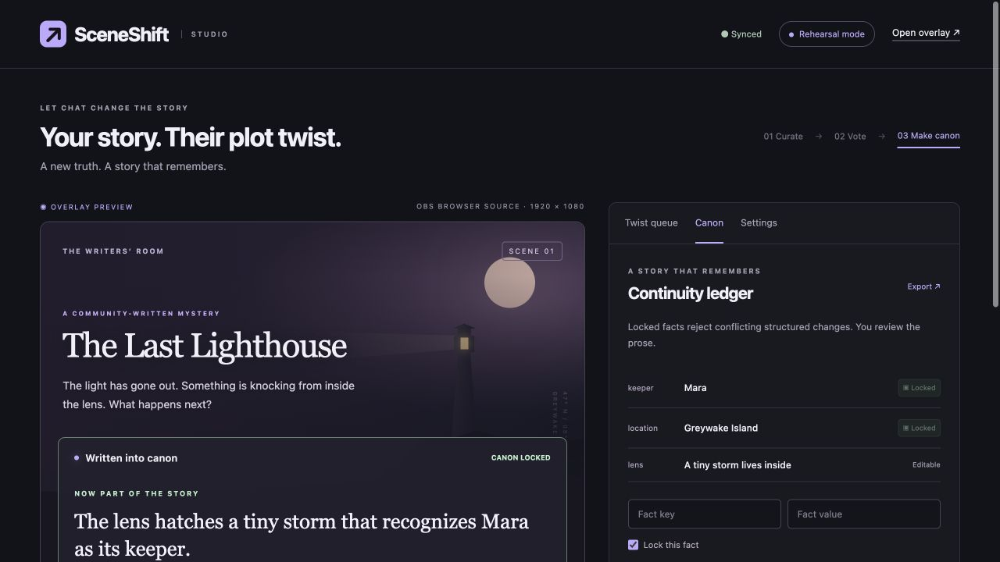

# SceneShift ↗

**Your story. Their plot twist.** A Twitch writers’ room for narrative, role-play, and improv streams. Viewers pitch twists in chat, the streamer curates a shortlist, chat votes, and the streamer decides what becomes canon.

Built from scratch with OpenAI Codex on October 26, 2026 for the Codex x TwitchCon Hackathon. Build session: `01a17901-b64d-7043-9268-af05e280ce91`.



## Try it in two minutes

Requires **Node.js 22.16+** on macOS, Windows, or Linux and a modern browser. No dependency installation, database, AI key, or Twitch account is needed for rehearsal.

```sh
npm start
```

1. Open **http://localhost:3000**. Read the generated private studio key from `data/admin.key` and enter it in the studio. On macOS/Linux: `cat data/admin.key`; on PowerShell: `Get-Content data/admin.key`. Do not share or record the key.
2. Click **Add three sample twists**. Approve at least two in the queue. Expand **Attach a canon fact** on the storm twist and set `lens` → `A tiny storm lives inside` if desired.
3. Click **Open the vote**, then **Simulate 12 viewers**. With all three samples approved, the storm wins 6–4–2. Each simulated viewer has one vote.
4. **Close & reveal**, then **Make this canon**. The Canon tab shows the approved chapter and attached fact.
5. Add a next-scene prompt and **Start next scene**. Canon and facts persist. Open **http://localhost:3000/overlay** in another tab to see the broadcast view update live.

Rehearsal is explicitly labeled in the UI and overlay. These inputs exercise the same command parser and state engine as real Twitch messages. They do **not** prove live Twitch connectivity. Use the live checklist below before recording the submission video.

## Connect real Twitch chat

SceneShift is a **single-channel installed application**, run by its broadcaster. It uses OAuth authorization code flow and EventSub WebSockets. The broadcaster authorizes their own channel; no separate bot or Extension is required.

1. In the [Twitch developer console](https://dev.twitch.tv/console/apps), register a new application. Twitch may require account sign-in, two-factor authentication, a verified email, and a CAPTCHA; the account owner completes these steps.
2. Register this exact OAuth redirect URI: `http://localhost:3000/auth/callback`. If the console requires an app category, select an appropriate application integration category. Generate a client secret.
3. Copy `.env.example` to `.env`. Set `TWITCH_CLIENT_ID` and `TWITCH_CLIENT_SECRET` locally. Never paste the secret into chat, commit it, or include it in a recording. Keep `BASE_URL=http://localhost:3000` for this setup.
4. Restart `npm start`. Unlock the studio. Finish any current rehearsal and start an empty scene, or use **Settings → Reset rehearsal** after exporting anything you want to keep.
5. Open **Settings → Connect Twitch**. The broadcaster signs in and approves **`user:read:chat`**. The app subscribes to its own broadcaster ID and shows **Twitch · accountname** only when all subscriptions succeed.
6. In the real Twitch channel’s chat, send `!twist The lens hatches a tiny storm`. A second viewer sends a different twist. Approve them in SceneShift. Open voting; send `!vote 1` or `!vote 2` in Twitch chat. Verify the counts change in the overlay. A live stream is not needed to test chat; record the overlay actually being used on Twitch for the hackathon.
7. Add the overlay to OBS and test your stream as described below. Record real chat → studio → overlay behavior. Do not substitute the simulation for this footage.

Twitch permissions are read-only. SceneShift never sends chat messages, changes channel settings, deletes channel messages, or uses paid Twitch features. It also subscribes to chat deletion/clear events with the same scope. A deleted proposal is removed; if moderation affects a current vote or uncommitted result, that result is canceled rather than silently renumbered. Already committed canon remains streamer-owned history. Shared Chat messages from another originating channel are ignored.

Tokens are validated at connection and hourly, refreshed when validation fails and a refresh token is available, and stored only in `data/twitch.json` with restricted file permissions. **Disconnect** erases the local token record and closes sockets. To revoke the grant itself, use Twitch account connections. Network reconnects use backoff; server-directed migration preserves the existing subscriptions. Twitch does not replay messages lost during a network outage. The status badge exposes outages; rerun a vote if needed.

## OBS overlay

Add a **Browser Source** using `http://localhost:3000/overlay`, width **1920**, height **1080**. The page background is transparent; the story card sits at the bottom center. Put it above the video source. Turn off “Shutdown source when not visible” if you want it continuously connected. On another machine, use a properly deployed HTTPS URL instead of localhost.

The overlay requests a public projection even if opened in an authenticated browser. It never receives pending proposals, blocked-user lists, filters, or room activity. No studio key belongs in its URL. Viewers use Twitch chat; they do not need SceneShift accounts.

## Deterministic rules

- Collect → vote → reveal → canon → next scene. A result can be skipped by starting a new scene without committing it.
- `!twist <text>`: 1–180 characters, one proposal per viewer per scene, at most 50 submissions, all pending until approved. Up to 30 case-insensitive literal blocked phrases; local bans reject future input. Streamer moderation remains necessary.
- Approve 2–4 options. Vote duration is 10–300 seconds; UI presets are 15/45/90/300. Empty results can be retried for five minutes with the same approved choices; committed or nonempty results cannot be retried. Option numbers remain fixed for the vote.
- `!vote 1` through `!vote 4`: one vote per Twitch user ID, latest valid vote replaces the previous vote. Repeated message IDs are ignored. Invalid commands do nothing.
- Deadline is enforced server-side before processing commands. Most votes wins; ties favor earliest stage order (original submission order among approved options). Zero votes yields no winner.
- A winner does not enter canon until the streamer clicks **Make this canon**. No automatic AI authority. Committing twice is rejected.
- Optional structured fact effects are checked at approval and commit. Locked facts cannot change without an explicit streamer unlock before voting. **This does not detect arbitrary prose contradictions**; the streamer reviews each twist.
- Keep the most recent 12 canon entries, 20 facts, 30 completed-round summaries, 35 activity entries, and 2,000 message IDs. Export the ledger between sessions to preserve longer histories.
- There is **no runtime generative AI**. Codex built and tested the application; viewers provide the creative writing. Sample prompts and the original CSS lighthouse art are deterministic, not generated suggestions.

## Configuration

Node reads `.env` through the start command. Environment variables override file values.

| Variable | Default | Purpose |
|---|---|---|
| `HOST` | `127.0.0.1` | Listen address. Public/container deployments use `0.0.0.0`. |
| `PORT` | `3000` | HTTP port. |
| `BASE_URL` | `http://localhost:3000` | Exact browser-facing origin, also used for CSRF checks and OAuth redirects. HTTPS in production. |
| `ADMIN_KEY` | generated locally | At least 24 characters. Required if binding publicly. Only the streamer gets this key. |
| `DATA_DIR` | project `data/` | Private writable directory for state, local key, and Twitch tokens. Mount persistent storage. |
| `TWITCH_CLIENT_ID` | empty | Twitch application client ID. Required only for live integration. |
| `TWITCH_CLIENT_SECRET` | empty | Server-side Twitch secret. Required only for live integration. |
| `TWITCH_BROADCASTER_ID` | empty | Optional numeric Twitch ID restriction; rejects authorization by another account. |

Only `public/` files are served. `.env`, state, tokens, source, and key files have no HTTP route. The studio uses 12-hour HttpOnly, SameSite=Lax sessions (Secure on HTTPS), exact-origin POST checks, login throttling, bounded request bodies, and a restrictive content policy. Session login is intentionally separate from Twitch authorization; Twitch sign-in cannot claim studio control. Logout invalidates the session. Restarting invalidates all studio sessions; sign in again with the key.

State writes use atomic rename and file mode 0600. This is filesystem protection, not encryption. Back up the private data volume securely. Do not expose `data/` as static hosting. Designed for one process and one broadcaster, not multi-tenant or horizontally scaled hosting. Public deployments should sit behind a TLS reverse proxy with connection/request limits. The public read-only overlay has a 100-connection cap.

## Test and deploy

```sh
npm run check
npm test
```

Tests cover the state machine, moderation bounds, vote changes, tie/zero-vote behavior, deadlines, locked facts, canon transitions, HTTP authorization and persistence, plus mocked Twitch subscription/migration/revocation behavior. Browser rehearsal was also exercised. See [verification](docs/VERIFICATION.md) for tested versus pending evidence.

[Deployment guide](docs/DEPLOYMENT.md) includes a Docker build and a generic HTTPS server setup. No hosting account is required for local judging. Docker is optional and requires its own installed runtime.

## Submission kit

- [Devpost project story](docs/DEVPOST.md)
- [2:40 English demo script and shot list](docs/DEMO.md)
- [Submission and human-only steps](docs/SUBMISSION.md)
- [Architecture and source references](docs/ARCHITECTURE.md)

MIT licensed. All project artwork is original CSS/SVG; system fonts only, no external imagery or music. No runtime npm packages. Twitch is a third-party platform; this project is not an official Twitch or OpenAI product.
